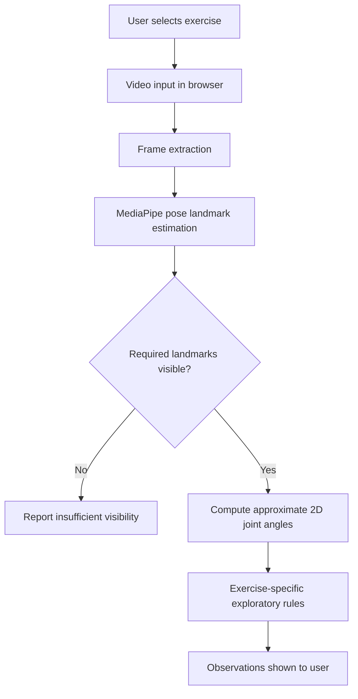

# System overview and architecture

This diagram is a simplified conceptual representation based on the project's README; it is not a claim about its complete production infrastructure.

## Core data considerations

- **Inputs:** uploaded exercise video; selected exercise type.
- **Intermediate data:** sampled frames, estimated landmarks and visibility/confidence information.
- **Derived data:** estimated 2D joint angles and exercise-specific observations.
- **Outputs:** visual feedback with limitations disclosed.

## Privacy boundaries

According to the project's documentation, uploaded-video processing occurs in the browser rather than uploading the video file to a first-party application server. Third-party libraries/models may be loaded online. Authentication is handled via Supabase Auth. This portfolio makes no claim that browser-side JavaScript is secret: code delivered to browsers is inherently inspectable.

## Engineering trade-offs

| Decision | Advantage | Limitation |
|---|---|---|
| Pretrained model | Rapid prototyping | Dependent on model quality and camera framing |
| 2D angles | Explainable calculations | No full 3D biomechanics |
| Browser processing | Avoids first-party video upload for analysis | Hardware and browser variance |
| Rule-based observations | Easy to communicate and test | No validated assessment of injury or correctness |
